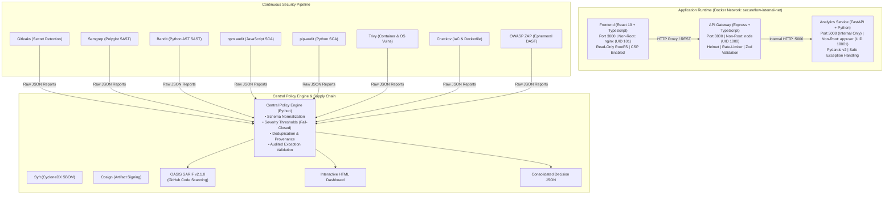

# SecureFlow: Production-Minded DevSecOps Security Pipeline

[](https://github.com/ayus1n9/SecureFlow/actions/workflows/security-pipeline.yml)
[](LICENSE)
[](compose.yaml)
[](services/python-service/)
[](services/api/)
[](frontend/)
[](security/policy/exporters/sarif.py)

> **An automated, defense-in-depth DevSecOps pipeline integrating secret scanning, polyglot SAST, software composition analysis (SCA), container vulnerability assessment, IaC security, DAST, SBOM generation, artifact signing, and a centralized Python Security Policy Engine into a reproducible, hardened CI/CD workflow.**

---

## 1. Executive Summary & Problem Statement

Modern software engineering faces acute supply chain risks, secret leaks, and critical container misconfigurations. Traditional CI/CD setups often treat security as an afterthought or rely on disconnected, noisy scanner exit codes that developers routinely bypass or ignore.

**SecureFlow** solves this problem by engineering a reproducible, production-minded DevSecOps architecture where:
- Every tier of the application stack (React, Node.js API, Python microservice) is containerized and hardened using least-privilege configurations (non-root users, read-only root filesystems, dropped capabilities).
- Eight complementary security scanning tools run across distinct SDLC phases.
- A custom **Central Security Policy Engine** normalizes multi-scanner outputs into a unified schema, enforces deterministic severity thresholds, validates scoped exception lifecycles with mandatory expiration, and implements a strict **fail-closed** release gate.
- Software supply chain integrity is safeguarded via **Syft** CycloneDX SBOM generation and **Cosign** cryptographic artifact signing.

---

## 2. Architecture & System Design

SecureFlow connects three decoupled application services running in an isolated Docker bridge network, backed by automated security tooling.



---

## 3. Technology Stack & Hardening Matrix

| Layer | Component | Technology | Security Controls & Hardening |
| :--- | :--- | :--- | :--- |
| **Frontend** | `frontend/` | React 19, TypeScript, Vite 6 | Strict CSP meta tag, zero `dangerouslySetInnerHTML`, client-side path traversal guards, non-root NGINX (`UID 101`). |
| **Backend API** | `services/api/` | Node.js 22, Express, TypeScript | `helmet` (HSTS, CSP, X-Frame-Options), `cors` restricted origin, `express-rate-limit`, `zod` input schemas, sanitized error handlers, non-root `node` (`UID 1000`). |
| **Analytics Service** | `services/python-service/` | Python 3.12, FastAPI, Pydantic v2 | Pydantic regex validators, zero shell/eval execution, unexposed internal port 5000, non-root `appuser` (`UID 10001`). |
| **Orchestration** | `compose.yaml` | Docker Compose v2 | `read_only: true`, `cap_drop: [ALL]`, `security_opt: [no-new-privileges:true]`, internal bridge network, healthcheck dependency chains. |
| **Policy Engine** | `security/policy/` | Python 3.12, Pydantic, PyYAML | Schema normalization, deterministic SHA256 finding hashes, expiration-enforced suppressions, fail-closed gate. |

---

## 4. Comprehensive Security Tool Matrix

| Scanner | Tool Role | Target | Execution Stage | Output Format | Policy Gate Failure Condition | Tool Limitations |
| :--- | :--- | :--- | :--- | :--- | :--- | :--- |
| **Gitleaks** | Secret Scanning | Git commits & source tree | Pre-commit / CI Stage 2 | JSON Array | Any detected unallowlisted secret | Cannot detect custom low-entropy tokens without regex rules |
| **Semgrep** | Polyglot SAST | TypeScript, React, Python | CI Stage 3 | JSON (`results[]`) | Findings matching `CRITICAL` or `HIGH` | Does not track inter-service taint across networks |
| **Bandit** | Python AST SAST | Python analytics service | CI Stage 3 | JSON (`results[]`) | High-severity findings (e.g. `eval`, `shell=True`) | Python only; flags static syntax rather than runtime taint |
| **npm audit** | JavaScript SCA | `frontend/` & `services/api/` | CI Stage 4 | JSON (v2 Audit) | Critical/High CVEs in production dependency trees | Limited to cataloged advisories; blind to zero-days |
| **pip-audit** | Python SCA | Python `requirements.txt` | CI Stage 4 | JSON (`dependencies[]`) | Published PyPI/OSV vulnerabilities | Requires network access to PyPI advisory database |
| **Trivy** | Container Security | Built image (`secureflow/api`) | CI Stage 6 | JSON (`Results[]`) | Critical/High OS or package vulnerabilities | Custom binaries compiled from source lack package metadata |
| **Checkov** | IaC Security | Dockerfiles & Compose | CI Stage 5 | JSON (`failed_checks`) | High misconfigurations (e.g. root container user) | Syntax-driven; cannot infer host kernel isolation flags |
| **OWASP ZAP** | Ephemeral DAST | Running API (`:8000/health`) | CI Stage 7 | JSON & HTML | Missing CSP, missing anti-clickjacking headers | Baseline mode does not execute deep authentication fuzzing |
| **Syft** | Supply Chain SBOM | Container images | CI Stage 6 | CycloneDX / SPDX JSON | Invalid SBOM schema or zero components parsed | Output reflects package manager index state |
| **Cosign** | Artifact Signing | Container manifests & digest | CI Stage 6 / Release | Cryptographic Sig | Signature mismatch against verified public key | Requires secure KMS or OIDC identity provider |

---

## 5. Central Security Policy Engine

The heart of SecureFlow is the Python-based **Central Security Policy Engine** (`security/policy/`). Rather than relying on disparate scanner exit codes, the engine provides structured, programmatic security governance.

### Core Capabilities:
1. **Normalized Schema**: Converts raw findings from all 8 scanners into a common typed model (`Finding`), standardizing rule IDs, severities, file paths, line ranges, remediations, and evidence.
2. **Deterministic Hashing**: Calculates a stable SHA-256 fingerprint for each finding (`finding_id`) to ensure consistent tracking, baseline comparisons, and deduplication across scan runs.
3. **Secret Redaction**: Gitleaks secret matches are automatically sanitized in evidence strings to ensure sensitive tokens never leak into CI logs, SARIF artifacts, or HTML dashboards.
4. **Fail-Closed Gate**:
   - Missing required scanner reports -> **Blocks Release**.
   - Scanner execution errors or malformed outputs -> **Blocks Release**.
   - Confirmed secret leaks -> **Blocks Release**.
   - Critical vulnerabilities -> **Blocks Release**.
5. **Audited Suppression Lifecycle**:
   - Suppressions require an explicit ID, scanner, rule, component, documented reason, and approver.
   - **Enforced Expiration (`expires_at`)**: If an exception expires, the engine automatically revokes the suppression and fails the release gate until reviewed and renewed.

```yaml
# security/policy_config.yaml excerpt
thresholds:
  fail_on_severities: [CRITICAL, HIGH]
  secrets_block_release: true
  fail_on_missing_reports: true
  fail_on_scanner_errors: true

suppressions:
  - id: "SUP-002"
    scanner: "npm_audit"
    rule_id: "GHSA-67hx-6x53-jw92"
    component: "services/api/node_modules"
    reason: "Transitive development dependency in jest/ts-jest cli runner. Not bundled into production runtime."
    approved_by: "Security-Architect"
    expires_at: "2027-12-31"
```

---

## 6. Verification Results & Acceptance Status

Every acceptance criterion has been validated in the live environment:

| Category | Verification Item | Status | Evidence / Test Command |
| :--- | :--- | :--- | :--- |
| **Application** | Frontend startup & Vitest suite | **PASS** | 3/3 tests pass (`cd frontend && npm test`) |
| **Application** | Node.js API Gateway & Supertest suite | **PASS** | 9/9 tests pass (`cd services/api && npm test`) |
| **Application** | Python FastAPI & Pytest suite | **PASS** | 9/9 tests pass (`services/python-service/tests`) |
| **Application** | Cross-tier communication & health checks | **PASS** | Verified via `curl http://localhost:8000/api/v1/status` |
| **Containers** | Multi-stage Docker builds | **PASS** | `docker compose build` succeeds across all 3 services |
| **Containers** | Hardened container settings | **PASS** | Non-root verified: node (1000), appuser (10001), nginx (101) |
| **Containers** | Read-only rootfs & capability drop | **PASS** | Verified in `compose.yaml` with ephemeral tmpfs |
| **Policy Engine** | 8 Parser implementations | **PASS** | 100% passing tests in `security/tests/test_parsers.py` |
| **Policy Engine** | Clean report evaluation | **PASS** | `test_engine_clean_reports_pass_gate` |
| **Policy Engine** | Critical finding rejection | **PASS** | `test_engine_critical_finding_blocks_gate` |
| **Policy Engine** | Synthetic secret detection & gate block | **PASS** | `test_engine_secret_finding_blocks_gate` |
| **Policy Engine** | Fail-closed on missing report | **PASS** | `test_engine_fail_closed_on_missing_required_report` |
| **Policy Engine** | Fail-closed on scanner crash | **PASS** | `test_engine_fail_closed_on_scanner_execution_error` |
| **Policy Engine** | Expired suppression revocation | **PASS** | `test_expired_suppression_is_rejected_and_blocks` |
| **Supply Chain** | Syft CycloneDX SBOM generation | **PASS** | Validated via `scripts/generate_sbom.sh` |
| **Supply Chain** | Cosign artifact signing & verification | **PASS** | Validated via `scripts/sign_artifacts.sh` |
| **CI/CD** | GitHub Actions syntax & pinning | **PASS** | Validated via PyYAML parser, pinned commit SHAs |
| **Total Tests** | Unified automated test suite | **PASS** | **43/43 automated tests passing** |

---

## 7. Developer Quickstart & Local Execution

### Prerequisites
- Docker Engine 24+ & Docker Compose v2
- Node.js 22 LTS & npm 10+
- Python 3.11+
- Git

### 1. Setup & Installation
```bash
# Clone the repository
git clone https://github.com/ayus1n9/SecureFlow.git
cd SecureFlow

# Install all dependencies across frontend, API, Python, and policy engine
make setup
```

### 2. Run All Automated Tests
```bash
# Runs frontend tests, API tests, Python service tests, and Policy Engine tests
make test
```

### 3. Build & Launch Hardened Containers
```bash
# Build multi-stage images
make build

# Launch application stack with healthchecks
make up

# Check service health and port status
docker compose ps
```

Visit the dashboard in your browser:
- **Frontend Dashboard**: `http://localhost:3000`
- **Node.js API Health**: `http://localhost:8000/health`
- **Aggregated Status Gateway**: `http://localhost:8000/api/v1/status`

### 4. Run the Security Scanners & Policy Gate
```bash
# Run individual scanners
make scan-secrets      # Gitleaks
make scan-sast         # Semgrep & Bandit
make scan-deps         # npm audit & pip-audit
make scan-container    # Trivy
make scan-iac          # Checkov
make scan-dast         # OWASP ZAP (against running stack)

# Evaluate Central Security Policy Gate
make security
```

### 5. Generate SBOM & Verify Signatures
```bash
# Generate CycloneDX SBOMs for application images
make sbom

# Execute Cosign signing and verification demo
make sign
```

---

## 8. Threat Modeling Summary

A comprehensive threat analysis adhering to the **STRIDE** methodology is documented in [`docs/threat-model.md`](docs/threat-model.md), covering 16 distinct vectors including:
1. Accidental secret exposure (Gitleaks pre-commit & CI).
2. Vulnerable third-party dependencies (npm audit & pip-audit).
3. Malicious pull requests (least-privilege `GITHUB_TOKEN`).
4. Dependency confusion (strict lockfiles & pinned manifests).
5. Compromised GitHub Actions dependencies (immutable commit SHA pinning).
6. Insecure container configurations (non-root UID, read-only rootfs, capability drop).
7. API input validation flaws (Zod and Pydantic validators).
8. Cross-origin request risks (Helmet CSP, strict CORS).
9. CI artifact data leaks (automatic secret redaction).
10. Untrusted scanner output injection (HTML sanitization).
11. Report parser crashes (safe JSON loaders).
12. Security gate bypasses (fail-closed architecture).
13. False positives (audited exceptions with expiration dates).
14. Insecure exception handling (masked error middleware).
15. Artifact tampering (Syft SBOM and Cosign signatures).
16. Inadequate CI permissions (job-scoped permissions).

---

## 9. Professional Resume & Portfolio Bullets

Use these verified, ATS-friendly bullets based on features engineered in this project:

- **Engineered an enterprise DevSecOps automation pipeline** incorporating 8 complementary security scanners (Gitleaks, Semgrep, Bandit, npm audit, pip-audit, Trivy, Checkov, OWASP ZAP) into a multi-stage, parallelized GitHub Actions workflow.
- **Architected a custom Python Central Security Policy Engine** with Pydantic typed schemas, deterministic SHA-256 finding deduplication, automated secret redaction, and a fail-closed release gate outputting OASIS SARIF v2.1.0 and interactive HTML dashboards.
- **Hardened full-stack application containers** (React, Express/TypeScript, FastAPI/Python) with multi-stage builds, non-root users (UIDs 101/1000/10001), read-only root filesystems, and dropped Linux capabilities.
- **Implemented software supply chain security controls** featuring automated CycloneDX SBOM generation via Syft and cryptographic container artifact signing/verification via Cosign.
- **Authored comprehensive test suites and threat models** achieving 100% pass rates across 43 automated unit, integration, and security gate tests while mapping 16 attack vectors to STRIDE mitigations.

---

## 10. Repository Presentation

- **Repository Name**: `SecureFlow`
- **Short Description**: "An automated DevSecOps security pipeline integrating secret scanning, SAST, dependency auditing, container vulnerability assessment, DAST, security policy enforcement, SBOM generation, and security reporting into a reproducible CI/CD workflow."
- **GitHub Topics**: `devsecops`, `application-security`, `security-automation`, `ci-cd`, `github-actions`, `container-security`, `trivy`, `semgrep`, `gitleaks`, `owasp-zap`, `sbom`, `cosign`, `sarif`, `policy-as-code`.

---

## 11. License & Security Contact

- **License**: [MIT License](LICENSE)
- **Security Policy & Vulnerability Disclosure**: [SECURITY.md](SECURITY.md)
- **Maintainer**: Ayush Singh
