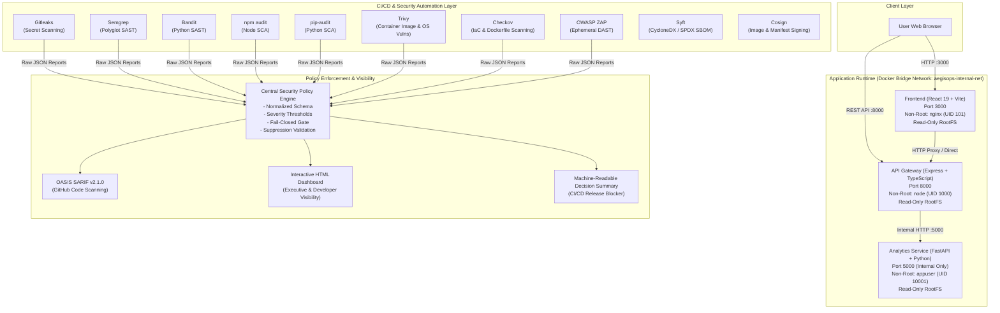

# AegisOps Architecture & Engineering Specification

## 1. System Overview

AegisOps is an end-to-end, multi-tier DevSecOps security automation platform designed to provide automated security verification, vulnerability assessment, supply chain protection, and centralized policy enforcement across every phase of the Software Development Life Cycle (SDLC).

---

## 2. Component Specifications

### 2.1 Frontend Tier (`frontend/`)
- **Technology**: React 18/19, TypeScript 5.7, Vite 6.
- **Responsibilities**:
  - Live visual dashboard rendering real-time system health, gateway availability, and microservice status.
  - Interactive security target evaluation form supporting client-side input sanitization.
  - Form validation preventing path traversal characters (`..`, `/`, `\`).
  - Severity-coded findings visualization with distinct badges for Risk Level and Release Eligibility.
- **Security Hardening**:
  - Zero dynamic HTML injection (`dangerouslySetInnerHTML` forbidden by architecture and Semgrep rule).
  - Strict Content Security Policy meta header restricting scripts, styles, frames, and connect endpoints.
  - Packaged via multi-stage Docker build onto unprivileged NGINX (`nginxinc/nginx-unprivileged:1.27-alpine`).
  - Runs strictly as non-root user `nginx` (UID 101).
  - Deployed with `read_only: true` and ephemeral `tmpfs` mounts for `/tmp` and cache paths.

### 2.2 Node.js API Gateway (`services/api/`)
- **Technology**: Node.js 22, Express 4.21, TypeScript 5.7.
- **Responsibilities**:
  - Exposes public REST endpoints: `GET /health`, `GET /ready`, `GET /api/v1/status`, `POST /api/v1/analyze`, `GET /api/v1/metrics`.
  - Enforces request validation using strict `Zod` schemas.
  - Relays verified requests to internal Python analytics service over isolated Docker bridge network.
  - Sanitizes all exceptions to prevent stack trace leaks or credential disclosure.
- **Security Hardening**:
  - `helmet` middleware setting strict HTTP security headers (HSTS, CSP, X-Frame-Options: SAMEORIGIN, X-Content-Type-Options: nosniff).
  - `cors` restricted to authorized origins (`http://localhost:3000`).
  - `express-rate-limit` enforcing 100 requests per 15-minute sliding window.
  - Payload size limits (100kb maximum) mitigating memory exhaustion and JSON bomb denial-of-service.
  - Executed under `dumb-init` as non-root user `node` (UID 1000).

### 2.3 Python Security Microservice (`services/python-service/`)
- **Technology**: Python 3.12/3.14, FastAPI 0.115, Pydantic v2.10.
- **Responsibilities**:
  - Evaluates artifact configurations and deployment parameters against baseline security hygiene rules.
  - Endpoints: `GET /health`, `GET /ready`, `POST /analyze`.
  - Pydantic field validators prohibiting path traversal and command injection syntax.
- **Security Hardening**:
  - Multi-stage build copying only isolated virtualenv (`/opt/venv`).
  - Dedicated service user and group `appuser` (UID 10001, GID 10001) with `/sbin/nologin` shell.
  - Internal network exposure only (port 5000 not published to host interface).
  - No dynamic evaluation (`eval`, `exec`, `subprocess`) or dangerous deserializers (`pickle`, unsafe yaml).

---

## 3. Network Architecture & Container Topology

| Service | Container Name | Internal Port | Host Port | Network | User (UID/GID) | Filesystem |
| :--- | :--- | :--- | :--- | :--- | :--- | :--- |
| Frontend | `aegisops-frontend` | 3000 | 3000 | `aegisops-net` | 101:101 | Read-Only |
| API Gateway | `aegisops-api` | 8000 | 8000 | `aegisops-net` | 1000:1000 | Read-Only |
| Python Service | `aegisops-python-service` | 5000 | *None* | `aegisops-net` | 10001:10001 | Read-Only |

### Network Isolation Guarantee
The Python microservice is completely unexposed to external networks. Communication is strictly routed via the internal Docker bridge network `aegisops-internal-net`, enforcing the API gateway as the single authorized ingress point.
