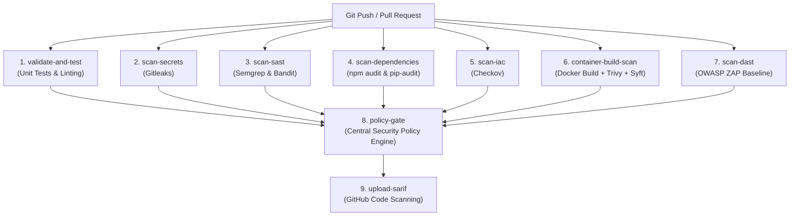

# SecureFlow CI/CD Pipeline & GitHub Actions Specification

## 1. Pipeline Execution Flow

The SecureFlow CI/CD pipeline runs on pushes to `main`, pull requests, and manual triggers (`workflow_dispatch`). Independent security scanners execute in parallel across isolated ephemeral runners to minimize build times while preserving strict dependency boundaries.



---

## 2. Job Catalog & Specifications

| Job ID | Name | Tooling | Execution Context | Timeout | Output Artifact |
| :--- | :--- | :--- | :--- | :--- | :--- |
| `validate-and-test` | Unit Tests & Linting | Vitest, Jest, Pytest | Node 22, Python 3.12 | 15 min | Test results |
| `scan-secrets` | Secret Scanning | Gitleaks v8.21.2 | Docker container | 10 min | `reports/gitleaks.json` |
| `scan-sast` | Static Analysis | Semgrep 1.98, Bandit 1.8 | Docker containers | 15 min | `reports/semgrep.json`, `bandit.json` |
| `scan-dependencies` | Dependency Auditing | npm audit, pip-audit 2.7 | Node 22, Docker | 10 min | `reports/npm_audit.json`, `pip_audit.json` |
| `scan-iac` | Infrastructure Security | Checkov 3.2 | Docker container | 10 min | `reports/checkov.json` |
| `container-build-scan` | Container & SBOM | Trivy, Syft v1.18 | Docker buildx | 15 min | `reports/trivy.json`, `reports/sbom/` |
| `scan-dast` | Ephemeral DAST | OWASP ZAP 2.15 | Docker Compose + ZAP | 15 min | `reports/zap.json`, `zap-report.html` |
| `policy-gate` | Security Gate | SecureFlow Policy Engine | Python 3.12 | 10 min | `security_summary.json`, `sarif`, `html` |
| `upload-sarif` | SARIF Publication | GitHub CodeQL Action | GitHub Runner | 5 min | GitHub Code Scanning Alerts |

---

## 3. GitHub Code Scanning Integration

The pipeline generates an OASIS SARIF v2.1.0 document consolidating findings across all static and dynamic scanners. 

### Enabling GitHub Code Scanning:
1. Navigate to your GitHub repository -> **Settings** -> **Code security and analysis**.
2. Enable **GitHub Advanced Security** (for private repositories) or verify that code scanning is active (free for public repositories).
3. The `upload-sarif` job automatically publishes findings to the **Security** tab under **Code scanning alerts**.

---

## 4. Live Verification & CI/CD Run Proof

In the live GitHub Actions environment, the pipeline executed across all 9 parallel jobs on the `main` branch:

```
✓ main SecureFlow DevSecOps Pipeline · Run #39118221923
Status: Success (All 9 jobs passed)

JOBS:
✓ Unit Tests & Linting (Node 22, Python 3.12, Vitest, Jest, Pytest)
✓ Gitleaks Secret Scanning
✓ SAST (Semgrep & Bandit)
✓ SCA Dependency Auditing (npm audit --omit=dev & pip-audit)
✓ IaC Security (Checkov on Dockerfiles & Compose)
✓ Container Build & Trivy Scan (Multi-stage build & CVE scan)
✓ Ephemeral DAST (OWASP ZAP against running Compose stack)
✓ Central Security Policy Gate (Fail-closed evaluation & report consolidation)
✓ Publish SARIF to GitHub Code Scanning (OASIS SARIF v2.1.0 publication)
```
